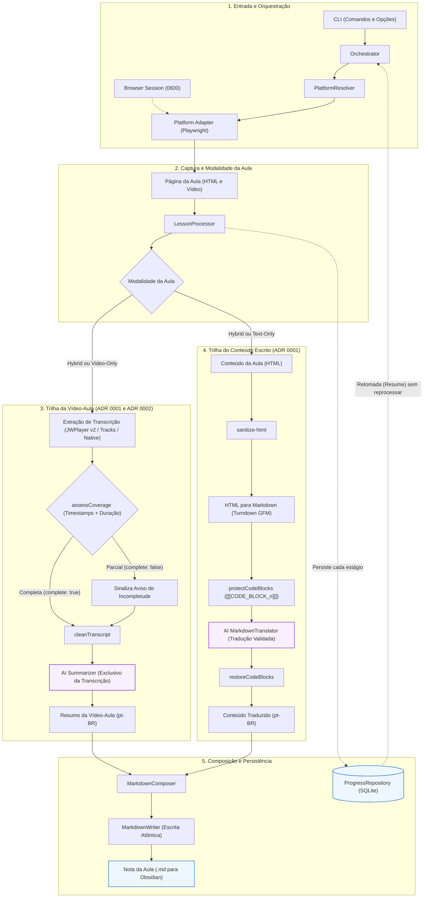

# universal-course-extractor

CLI em Node.js e TypeScript que acessa plataformas de cursos online (via Playwright e sessão de navegador autenticada), extrai transcrições e o conteúdo escrito das aulas, gera o **Resumo da Vídeo-Aula** (`Transcript Summary`) exclusivamente a partir da transcrição, **traduz integralmente** o **Conteúdo da Aula** (`Lesson Content`) para português (pt-BR) preservando blocos de código e formatação, e publica uma **Nota da Aula** (`Lesson Note`) estruturada em Markdown pronta para o Obsidian.

Documentos de referência fundamentais:
- [GLOSSARY.md](GLOSSARY.md) — Vocabulário canônico do domínio e termos a evitar.
- [CODING_STANDARDS.md](CODING_STANDARDS.md) — Padrões de código e invariantes arquiteturais.
- [docs/adr/](docs/adr/) — Decisões de Arquitetura (ADRs 0001, 0002 e 0003).
- [docs/platforms/skilljar.md](docs/platforms/skilljar.md) — Referência técnica do DOM e players do Skilljar.

Plataforma principal: **Anthropic Partner Academy (Skilljar)**. Inclui também o adaptador `generic` para testes e experimentação.

---

## Visão Geral da Arquitetura

O diagrama abaixo ilustra o ciclo de vida completo da aplicação: desde a captura autenticada no navegador até a separação estrita das trilhas de IA e a gravação atômica da nota final:



---

## Status e Capacidades

| Capacidade | Estado e Implementação |
| --- | --- |
| **Núcleo Agnóstico & Pipeline** | Pipeline desacoplado de plataforma com orquestrador, repositório de progresso SQLite, chunking semântico, isolamento estrito de IA e escrita atômica. Suíte completa de testes unitários e de contrato (`make test`). |
| **Skilljar & Layouts de Aula** | Suporte às 3 modalidades de página do Skilljar: **Vídeo + Painel de Resumo** (`#details-pane-summary-content`), **Guia Somente Texto** (`.course-text-content`) e **Somente Vídeo** (`video-only`). |
| **JWPlayer & Manifestos v2** | Extração direta dos manifestos da API v2 do JWPlayer (`cdn.jwplayer.com/v2/media/<mediaId>`) detectando tanto o Web Component `<sjwc-video>` quanto o container legado `videoJsArgs` / `botr_*_div`. Prioriza faixas de legenda em português (`pt-BR`/`pt`/`Portuguese`), com fallback para inglês (`en`). |
| **Inspeção de Aulas ao Vivo** | Utilitário `make inspect-lesson URL="..."` para verificar seletores DOM, presença de containers de vídeo e tokens de manifesto em páginas reais usando a sessão autenticada. |
| **Sessão do Navegador (`Browser Session`)** | Login manual assistido no Chromium (`headed`). A sessão é salva em `data/browser/skilljar-storage.json` com permissão estrita `0600` (fora do Git) e reutilizada nas execuções seguintes. |
| **Cobertura da Transcrição (`Transcript Coverage`)** | Validação obrigatória de cobertura temporal (`assessCoverage`): só marca `complete: true` (`status: "found"`) quando há evidência de múltiplos segmentos com timestamps (`start`/`end`) e duração positiva conhecida do vídeo. Leituras sem evidência de cobertura são classificadas como `partial` com aviso na nota. |
| **Modalidades de Aula (`Lesson Modality`)** | Aulas **Hybrid** (vídeo + texto), **Video-Only** (vídeo sem texto) e **Text-Only** (`noVideo: true`, razão `"No video in this lesson"`) são processadas e marcadas como `completed` assim que seus insumos são concluídos. |
| **Resumo & Tradução com IA Isolada** | `Summarizer` opera exclusivamente sobre a transcrição limpa gerando resumo pt-BR; `MarkdownTranslator` opera exclusivamente sobre o conteúdo escrito, protegendo blocos de código com placeholders `[[[CODE_BLOCK_n]]]` e validando cada trecho traduzido. |
| **Retomada de Progresso (`Resume`)** | Persistência granular de cada etapa (`transcript`, `content`, `summary`, `translation`) no SQLite (`node:sqlite`). Se interrompido (ex.: `Ctrl+C`), retoma de onde parou sem refazer chamadas de IA concluídas. |

---

## Requisitos

- **Node.js 20+** (recomendado Node.js 22+ ou 24+ com suporte nativo a `node:sqlite`).
- **Servidor de IA local** compatível com a API OpenAI (ex.: `llama.cpp` via `llama-server`, vLLM, Ollama).

> [!NOTE]
> Se `node` ou `npm` não estiverem no `PATH` em shells não-interativos (ex.: NVM), utilize o `make` (que auto-detecta o NVM) ou configure:
> ```bash
> export PATH="$(ls -d $HOME/.config/nvm/versions/node/*/bin $HOME/.nvm/versions/node/*/bin 2>/dev/null | tail -n 1):$PATH"
> ```

---

## Instalação e Setup

O projeto inclui um [Makefile](Makefile) com atalhos para todas as tarefas de ciclo de vida e manutenção.

### Setup automatizado com `make` (recomendado)

```bash
make setup
make check
```

O comando `make setup` realiza todo o processo:
1. Copia `.env.example` para `.env` e `config/platforms.example.yaml` para `config/platforms.yaml` (sem sobrescrever caso existam).
2. Instala dependências npm e o navegador Chromium do Playwright.
3. Instala o hook de Git `pre-commit` para verificação de tipos e testes unitários.
4. Valida as configurações do ambiente (`check-config`).

### Instalação manual com `npm`

```bash
npm install
npx playwright install chromium
cp .env.example .env
cp config/platforms.example.yaml config/platforms.yaml
npm run typecheck && npm test
npm run check-config
```

Para verificar o ambiente e a saúde da configuração a qualquer momento, execute:
```bash
make doctor
```

---

## Configuração do Servidor de IA

O pipeline utiliza qualquer servidor local compatível com a API OpenAI. Exemplo com `llama.cpp`:

```bash
llama-server -m /caminho/para/modelo.gguf --host 127.0.0.1 --port 8080 -c 16384
```

No arquivo `.env`:

```env
AI_BASE_URL=http://127.0.0.1:8080/v1
AI_API_KEY=local
AI_MODEL=nome-do-modelo
AI_TEMPERATURE=0.2
AI_MAX_TOKENS=8192
AI_TIMEOUT=120000
AI_MAX_RETRIES=3
AI_CHUNK_CHARS=6000
```

- **`AI_CHUNK_CHARS`**: Define o tamanho máximo de caracteres de cada bloco enviado ao modelo de tradução. Mantenha uma margem confortável em relação à janela de contexto (`-c`) menos `AI_MAX_TOKENS`.
- **`AI_MAX_RETRIES`**: Limita as tentativas de repetição por bloco de tradução (em caso de falha de validação ou erro de rede).
- **Proteção contra injeção**: Todo conteúdo textual externo extraído das aulas é envolvido por delimitadores não confiáveis (`<<<CONTEUDO>>>` ... `<<<FIM>>>`) nos prompts.

### Testando o funcionamento do modelo de IA

Antes de iniciar extrações de cursos, valide se o modelo configurado está respondendo, resumindo e traduzindo corretamente:

```bash
make test-ai
# ou com testes detalhados Vitest:
make test-ai-vitest
```

Esse comando executa 3 verificações reais contra o seu modelo:
1. **Conectividade:** verifica `/v1/models` e a latência de resposta.
2. **Resumo (`Summarizer`):** envia uma transcrição de teste em inglês e valida a geração estruturada do resumo em pt-BR.
3. **Tradução (`MarkdownTranslator`):** envia um trecho Markdown com títulos, links, tabela e blocos de código cercados, conferindo se os blocos de código `[[[CODE_BLOCK_n]]]` foram preservados intactos.

---

## Autenticação e Inspeção da Plataforma

### Autenticação (`Browser Session`)

```bash
make auth URL="https://anthropic-partners.skilljar.com/<curso>"
# ou diretamente via npm:
npm run auth -- --url "https://anthropic-partners.skilljar.com/<curso>"
```

1. O navegador Chromium é aberto em modo gráfico (`headed`).
2. Você realiza o login manualmente na plataforma.
3. Após autenticado, retorne ao terminal e pressione `Enter`.
4. A **Sessão do Navegador** (`storageState`) é gravada em `data/browser/skilljar-storage.json` com permissão estrita `0600`. Senhas e tokens nunca são armazenados pelo código da aplicação.

### Inspeção de Aulas ao Vivo

Para verificar os seletores do DOM, layout da aula e metadados de vídeo (JWPlayer) usando a sessão autenticada salva:

```bash
make inspect-lesson URL="https://anthropic-partners.skilljar.com/<curso>/<aula>"
```

Esse comando analisa se a aula possui `#details-pane-summary-content`, seletor `.course-text-content`, Web Component `<sjwc-video>`, ou script `videoJsArgs`, exibindo os identificadores detectados.

---

## Uso da CLI

### Comandos Principais

```bash
# Descobrir cursos disponíveis
make courses URL="https://anthropic-partners.skilljar.com"

# Listar aulas de um curso
make lessons URL="https://anthropic-partners.skilljar.com/<curso>"

# Simular extração sem chamar IA nem gravar arquivos (dry-run)
make dry-run URL="https://anthropic-partners.skilljar.com/<curso>" ALL=1

# Extrair uma única aula específica (pela posição original, começando em 1)
make scrape URL="https://anthropic-partners.skilljar.com/<curso>" LESSON=1

# Extrair aulas selecionadas ou intervalos
make scrape URL="https://anthropic-partners.skilljar.com/<curso>" LESSONS="1,3,5-7"
make scrape URL="https://anthropic-partners.skilljar.com/<curso>" FROM=1 TO=5

# Extrair o curso inteiro para um diretório específico (ex.: vault do Obsidian)
make scrape URL="https://anthropic-partners.skilljar.com/<curso>" ALL=1 OUTPUT="/meu/vault/Obsidian/Cursos"

# Retomar processamento interrompido
make resume

# Ver o status do banco de dados (SQLite) e sessões
make status

# Ver logs estruturados recentes
make logs
```

### Opções e Flags da CLI

Ao usar `npm run scrape -- [opções]`, estão disponíveis:

| Opção | Descrição |
| --- | --- |
| `--url <url>` | URL do curso ou aula. |
| `--course <nome>` | Filtra ou define o título do curso. |
| `--platform <nome>` | Força a plataforma (`skilljar`, `generic`). |
| `--lesson <n>` | Extrai apenas a aula na posição `n` (base 1). |
| `--lessons <lista>` | Lista/intervalos de aulas (ex.: `1,3,5-7`). |
| `--from <n> --to <m>` | Intervalo de aulas da posição `n` até `m`. |
| `--all` | Processa todas as aulas descobertas no curso. |
| `--output <dir>` | Diretório de destino das notas Markdown (padrão: `dist/<curso>/`). |
| `--overwrite` | Reprocessa e sobrescreve notas existentes. |
| `--skip-existing` | Pula aulas já concluídas no SQLite e presentes no disco. |
| `--dry-run` | Executa o planejamento sem chamar IA nem gravar arquivos. |
| `--headed` / `--headless` | Força exibição ou ocultação da janela do navegador. |
| `-y, --yes` | Modo não interativo (assume respostas padrão). |

> [!NOTE]
> Políticas de conflito de arquivo: por padrão, a CLI pergunta interativamente se deve sobrescrever. Use `--skip-existing` para pular arquivos já gerados ou `--overwrite` para reprocessar integralmente. Opções mutuamente conflitantes são rejeitadas.

---

## Formato da Nota da Aula (`Lesson Note`)

Cada aula gera um documento Markdown otimizado para o Obsidian, gravado atomicamente em `dist/<nome-do-curso>/NN-slug-da-aula.md`:

```markdown
---
title: "Título da Aula"
platform: "skilljar"
course: "Nome do Curso"
lesson_id: "anthropic-partners.skilljar.com/page/aula-1"
position: 1
source_url: "https://anthropic-partners.skilljar.com/page/aula-1"
transcript_status: "found"
transcript_source: "captions"
transcript_complete: true
language: "pt-BR"
generated_at: "2026-11-13T18:00:00.000Z"
tags:
  - curso
  - skilljar
---

# Título da Aula

## Resumo da transcrição

Dois parágrafos de síntese estruturada gerados exclusivamente a partir da fala da vídeo-aula.

### Principais conceitos
- Conceito 1 com explicações detalhadas...
- Conceito 2 preservando termos técnicos...

### Pontos importantes
- Boas práticas e exemplos destacados no vídeo...

> [!note]- Transcrição completa
> 00:00:01 Olá e bem-vindos a esta aula...
> 00:00:15 Vamos demonstrar o funcionamento...

---

## Conteúdo da aula

Material didático escrito extraído da página e traduzido integralmente para pt-BR. Todos os níveis de títulos são rebaixados 2 níveis (ex.: `#` vira `###`), blocos de código cercados são mantidos idênticos aos originais, e links e tabelas são preservados.
```

### Comportamento por Modalidade da Aula (`Lesson Modality`)

- **Hybrid Lesson (Vídeo + Conteúdo Escrito):** Inclui o resumo da transcrição da vídeo-aula, transcrição colapsável e o conteúdo traduzido da aula.
- **Video-Only Lesson (Apenas Vídeo):** Apresenta o resumo e a transcrição da vídeo-aula. Na seção de conteúdo, exibe a indicação de aula sem material textual adicional. É finalizada como `completed`.
- **Text-Only Lesson (Apenas Guia Textual):** A transcrição é sinalizada com `noVideo: true`. A nota destaca `_Aula somente textual (sem vídeo)._` e traz a tradução integral do guia didático. É finalizada como `completed`.
- **Transcrição Parcial (`partial`):** Quando a transcrição não possui evidência de cobertura temporal completa, a nota inclui um aviso `> [!warning] Transcrição possivelmente incompleta`.

---

## Como Funciona a Arquitetura

O fluxo foi concebido respeitando separação estrita de responsabilidades e decisões de arquitetura documentadas em [docs/adr/](docs/adr/):

```
CLI → Orchestrator → PlatformResolver / AdapterRegistry → PlatformAdapter (Playwright)
    → LessonProcessor:
        1. Identificação da Modalidade da Aula (Hybrid, Video-Only, Text-Only)
        2. Extração de Transcrição (JWPlayer v2 API / TextTracks / Native / Speech) + Cobertura
        3. Sanitização HTML (sanitize-html) → Conversão HTML→Markdown (Turndown GFM)
        4. IA Isolada: Summarizer (somente cleanTranscript) → Resumo estruturado pt-BR
        5. IA Isolada: MarkdownTranslator (somente Markdown com placeholders [[[CODE_BLOCK_n]]])
        6. Composição da Nota da Aula (MarkdownComposer) → Escrita atômica (MarkdownWriter)
        7. Persistência de cada etapa no SQLite (ProgressRepository via node:sqlite)
```

### Invariantes e Decisões de Arquitetura

1. **Separação estrita de operações de IA ([ADR 0001](docs/adr/0001-separate-transcript-summary-from-content-translation.md)):**
   - O `Summarizer` recebe **exclusivamente** a transcrição limpa do vídeo e produz o resumo pt-BR. Nunca tem contato com o HTML ou Markdown da página.
   - O `MarkdownTranslator` recebe **exclusivamente** o conteúdo escrito da aula convertido para Markdown. Blocos de código cercados são substituídos por marcadores `[[[CODE_BLOCK_n]]]` antes do envio à IA e restaurados na volta. Cada trecho traduzido é validado para garantir que links, marcadores, cabeçalhos e tabelas foram preservados.
   - Textos externos são encapsulados com delimitadores não confiáveis `<<<CONTEUDO>>>` ... `<<<FIM>>>`.

2. **Evidência de cobertura obrigatória para transcrições ([ADR 0002](docs/adr/0002-require-coverage-evidence-for-complete-transcripts.md)):**
   - Uma transcrição só recebe `complete: true` e `status: "found"` quando a função `assessCoverage` comprova múltiplos segmentos temporais (`start`/`end`) e duração positiva finita da mídia. Transcrições capturadas sem cobertura total geram `status: "partial"`.

3. **Manifestos JWPlayer antes de automação de interface ([ADR 0003](docs/adr/0003-extract-jwplayer-manifests-before-ui-automation.md)):**
   - Em players JWPlayer no Skilljar (`<sjwc-video>` e `videoJsArgs`), o sistema faz a extração direta do manifesto HTTP v2 (`https://cdn.jwplayer.com/v2/media/<mediaId>`) e faz download do arquivo `.srt`/`.vtt` original. Isso evita a fragilidade de clicar em botões de legendas no player da tela e obtém os timestamps exatos de cada fala.

4. **Persistência granular e retomada segura ([CODING_STANDARDS.md](CODING_STANDARDS.md)):**
   - O progresso de cada aula é salvo no SQLite imediatamente após o término de cada estágio (`transcript`, `content`, `summary`, `translation`).
   - Se o processo for interrompido, `make resume` reutiliza os estágios concluídos sem gastar chamadas adicionais de IA.
   - As notas finais são escritas via `MarkdownWriter` com escrita atômica (arquivo temporário seguido de `rename`), prevenindo arquivos corrompidos em caso de parada forçada.
   - Consultas SQL no `node:sqlite` utilizam parâmetros de substituição (`?`) para evitar erros com aspas e injeção.

5. **Segurança e privacidade:**
   - Logs gerados via Pino filtram e redigem tokens, credenciais e cookies.
   - Sessões do navegador em `data/browser/` utilizam máscara de permissão `0600`.
   - Nenhum script da página é injetado fora de leituras estritas no navegador (`evaluate`). Todo HTML capturado é sanitizado com `sanitize-html` antes da conversão para Markdown.

---

## Plataforma Skilljar

Para detalhes aprofundados sobre os seletores, layouts e comportamento do JWPlayer no Skilljar, consulte a documentação dedicada em [docs/platforms/skilljar.md](docs/platforms/skilljar.md):
- **Layout 1 (Vídeo + Summary Pane):** Vídeo em `#lesson-main-content` e texto em `#details-pane-summary-content`.
- **Layout 2 (Guia Somente Texto):** Conteúdo em `sjwc-lesson-content-item.course-text-content` sem player de vídeo.
- **Layout 3 (Somente Vídeo):** Shell com vídeo em `#lesson-main-content` sem container textual.
- **JWPlayer Embedding:** Detecção de `<sjwc-video video-id="..." token="...">` com token JWT para URL assinada, e `videoJsArgs.assetJWPlayerUrl` com extração de `mediaId`.

---

## Adicionando uma Nova Plataforma

A arquitetura desacoplada permite criar novos adaptadores sem alterar o orquestrador, o processador de aulas, o chunker ou os módulos de IA:

1. Crie `src/platforms/<nome>/<nome>.adapter.ts` implementando a interface `CoursePlatformAdapter` ([contrato](src/platforms/contracts/course-platform-adapter.ts)).
2. Implemente os métodos de extração de título, descoberta de aulas e obtenção do conteúdo bruto da aula.
3. Utilize o motor padrão de transcrição (`createDefaultTranscriptExtractor`) ou adicione estratégias especializadas.
4. Registre o novo adaptador no composition root em [src/platforms/runtime.ts](src/platforms/runtime.ts) e configure a seção correspondente em `config/platforms.yaml`.
5. Execute a suíte de contrato padronizada em `tests/contracts/`:
   ```ts
   import { runAdapterContract } from "../contracts/adapter-contract.js";

   runAdapterContract("MeuAdapter", {
     create: () => new MeuAdapter(/* dependências */),
     supportedUrl: "https://minha.plataforma.com/curso",
     unsupportedUrl: "https://outra-plataforma.com/curso",
   });
   ```

---

## Estrutura do Projeto

```
src/
├── core/         # Orquestrador, processador de aulas, runner do curso e montagem do pipeline
├── platforms/    # Contratos, adaptadores de plataforma (Skilljar, Generic) e runtime
├── browser/      # Gerenciamento de navegador Playwright, sessões (storageState 0600) e autenticação
├── extraction/   # Motor de transcrição, estratégias de extração, integridade e cobertura
├── processors/   # Sanitização HTML, Turndown GFM, chunking semântico, tradutor e compositor
├── ai/           # Cliente OpenAI-compatível, prompts isolados, summarizer, translator e testes
├── storage/      # Banco SQLite (node:sqlite), repositórios de progresso e escrita atômica
├── discovery/    # Seleção e descoberta de cursos e aulas
├── cli/          # Comandos da CLI, opções, prompts interativos e relatórios de progresso
└── config/       # Schemas Zod, carregamento de configuração e logger Pino estruturado

docs/
├── adr/          # Architectural Decision Records (ADRs 0001, 0002, 0003)
└── platforms/    # Referência técnica de plataformas (Skilljar DOM, layouts, JWPlayer)

data/             # Arquivos de execução local (fora do Git)
├── browser/      # Sessões salvas do navegador (skilljar-storage.json)
├── database/     # Banco de progresso progress.sqlite
├── logs/         # Logs estruturados (app.log) e capturas de tela de erro
└── transcripts/  # Transcrições salvas (.txt, .meta.json, .segments.json)

dist/             # Diretório padrão para as Notas da Aula geradas em Markdown
```

---

## Documentação e Referências

- [GLOSSARY.md](GLOSSARY.md) — Glossário oficial de termos e vocabulário canônico do domínio.
- [CODING_STANDARDS.md](CODING_STANDARDS.md) — Padrões de código, isolamento de IA e regras de persistência.
- [ADR 0001: Separação de Resumo e Tradução](docs/adr/0001-separate-transcript-summary-from-content-translation.md) — Decisão de isolamento estrito entre transcrição e conteúdo escrito.
- [ADR 0002: Exigência de Cobertura para Transcrições](docs/adr/0002-require-coverage-evidence-for-complete-transcripts.md) — Critérios de validação temporal antes de marcar `complete: true`.
- [ADR 0003: Extração de Manifestos JWPlayer v2](docs/adr/0003-extract-jwplayer-manifests-before-ui-automation.md) — Priorização de extração HTTP de legendas com ordenação pt > en.
- [docs/platforms/skilljar.md](docs/platforms/skilljar.md) — Seletores e layouts do Skilljar e JWPlayer.
